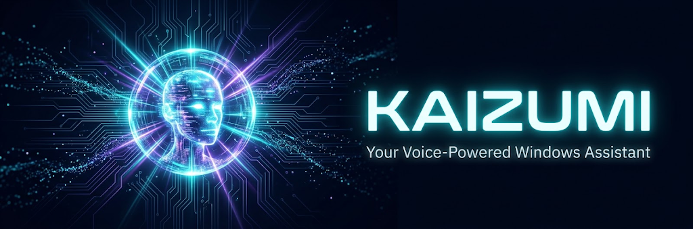
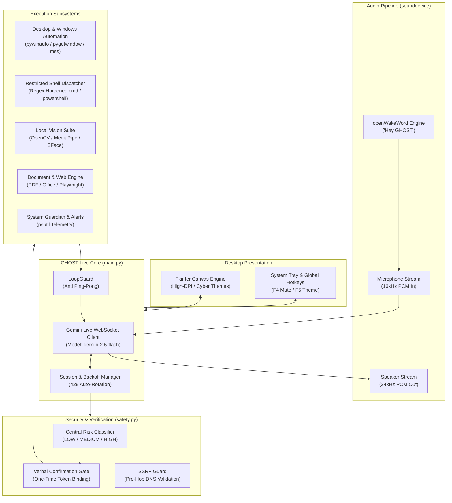

<p align="center">
  
</p>

<p align="center">
  <b>Real-Time, Voice-Driven Multimodal AI Companion for Windows</b><br>
  <i>Sub-second speech-to-speech interaction, desktop vision, autonomous tooling, and hardened local automation.</i>
</p>

<p align="center">
  <a href="https://github.com/MusayevDoniyor/kaizumi/actions/workflows/ci.yml"></a>
  <a href="https://www.python.org/"></a>
  <a href="https://opensource.org/licenses/MIT"></a>
  <a href="https://www.microsoft.com/windows"></a>
  <a href="https://ai.google.dev/"></a>
</p>

<p align="center">
  <a href="#-project-overview">Overview</a> •
  <a href="#-system-architecture">Architecture</a> •
  <a href="#-features--tooling">Features & Tools</a> •
  <a href="#-quick-start">Quick Start</a> •
  <a href="#-security--safety-model">Security Model</a> •
  <a href="#-configuration">Configuration</a> •
  <a href="#-telegram-remote-control">Telegram Remote</a> •
  <a href="#-testing--verification">Testing</a> •
  <a href="#-roadmap">Roadmap</a> •
  <a href="#-contributing">Contributing</a>
</p>

---

## 💡 Project Overview

**GHOST** is an open-source, on-device AI companion built for Windows 10 and 11. Unlike traditional text-based chatbots or turn-by-turn speech wrappers, GHOST connects directly to Google's **Gemini Live API** via bidirectional WebSocket audio streaming (PCM 24kHz/16kHz), delivering natural, conversational speech with human-level latency and real-time interruption (barge-in) support.

Equipped with screen awareness, local computer vision, persistent episodic memory, and a hardened system dispatch engine, GHOST can monitor system metrics, manage windows and files, write and run automation scripts, conduct research, control smart home devices, and guard user privacy—all while maintaining an animated cyber-themed desktop UI.

### Who Is GHOST For?
- **Developers & Power Users:** Seeking a customizable, local-first alternative to proprietary desktop assistants.
- **AI & Systems Researchers:** Exploring practical real-time multimodal tool use, human-in-the-loop safety gates, and low-latency audio pipelines.
- **Open-Source Enthusiasts:** Looking for a clean, extensible codebase with zero telemetry, zero forced subscriptions, and full self-hosting control.

> 👥 **Authors & Collaborators:**  
> - **Doniyor Musayev (Kaizo)** ([@MusayevDoniyor](https://github.com/MusayevDoniyor)) — Lead author & maintainer  
> - **Otabek Abduvaliyev** ([@OtabekAbduvaliyev](https://github.com/OtabekAbduvaliyev)) — Collaborator & contributor  
> 📜 **License:** [MIT Open Source License](LICENSE)

---

## 🏗️ System Architecture

GHOST operates on a decoupled, asynchronous event loop powered by Python `asyncio`. Audio input and output streams run independently from the UI loop and background watchdog tasks, guaranteeing that hardware disconnections, high tool latency, or network hiccups never freeze the application.



---

## ✨ Features & Tooling

GHOST exposes **53 declarative tool definitions** to the model. Each tool is executed with hard timeouts, error recovery, and risk boundary checks.

| Category | Capabilities & Implemented Tools | Local vs. Cloud |
| :--- | :--- | :--- |
| 🎙️ **Real-Time Voice** | Bidirectional live speech streaming, low-latency turn-taking, barge-in support, 30+ customizable Gemini voices, wake-word listener (`actions/wake_word.py`). | Cloud LLM + Local Audio |
| 🖥️ **Windows Automation** | Window management, app launching, typing, mouse control, file organization, media playback, system settings (volume/brightness/lock). | 100% Local |
| 🔒 **Safety & Risk Gate** | Centralized risk evaluation (`safety.py`). Destructive actions require explicit verbal consent bound to a single-use token (`confirm_token`). | 100% Local |
| 👁️ **Visual Awareness** | Screen capture understanding, active window inspection, webcam vision, privacy face blur, gesture recognition, and local arcade games. | Local CV + Cloud VLM |
| 🧠 **Persistent Memory** | Episodic memory (`memory/memory.py`) extracting preferences, user details, and plans across restarts with TTL expiration and automatic secret redaction. | 100% Local |
| 🛡️ **Guardian Telemetry** | Background watchdog monitoring battery level, RAM consumption, CPU spikes, disk space, and temperatures with spoken alerts. | 100% Local |
| 📄 **Document & Web QA** | Instant question-answering over PDF, DOCX, PPTX, XLSX, and web pages with SSRF-protected HTTP fetching. | Local parsing + Cloud QA |
| 🌐 **Headless Browser** | Automated Chromium browsing via Playwright (`actions/browser_control.py`) for live web navigation, clicking, typing, and scraping. | Local Browser |
| 💬 **Telegram Control** | Secure remote control from any Telegram chat (`telegram_bot.py`). Supports text commands, voice note transcription, and screen snapshots. | Cloud Polling (Fail-Closed) |
| 🏠 **Smart Home** | Integration with Home Assistant, webhooks, or local simulated smart devices. | Local / LAN |

---

## 📦 Requirements

- **Operating System:** Windows 10 or Windows 11 (64-bit).
- **Python Runtime:** Python **3.11, 3.12, 3.13, or 3.14**.
- **Hardware:**
  - Standard microphone and speakers / headphones.
  - Webcam (optional, only required for computer vision / face verification features).
- **API Key:** A free Google Gemini API key from [Google AI Studio](https://aistudio.google.com/apikey).

---

## 🚀 Quick Start

### 1. Clone the Repository
```powershell
git clone https://github.com/MusayevDoniyor/kaizumi.git
cd ghost
```

### 2. Create and Activate Virtual Environment
```powershell
python -m venv .venv
.\.venv\Scripts\activate
```

### 3. Run One-Shot Setup
The setup script installs pinned dependencies, prepares Playwright Chromium, and initializes default configuration templates:
```powershell
python setup.py
```

### 4. Configure Your Gemini API Key
Open `config/api_keys.json` and insert your Gemini API key:
```jsonc
{
    "gemini_api_key": "AIzaSyYourActualKeyHere...",
    "gemini_api_keys": [],
    "telegram_bot_token": "",
    "telegram_chat_id": null
}
```
*(Alternatively, set the `GHOST_GEMINI_API_KEY` environment variable in your shell).*

### 5. Launch GHOST
```powershell
python main.py
```
GHOST's animated interface will appear on your screen and greet you. You can speak naturally through your microphone or type commands directly into the terminal or UI console.

---

## 🛡️ Security & Safety Model

Because GHOST possesses desktop and command execution privileges, security is treated as an architectural invariant:

1. **Centralized Risk Hierarchy (`safety.py`):**
   - **`Risk.LOW`:** Read-only operations (web search, reading documents, weather, time, system status). Never require confirmation.
   - **`Risk.MEDIUM`:** Reversible state changes (opening applications, setting timers, clipboard changes).
   - **`Risk.HIGH`:** Irreversible or destructive operations (deleting files, running arbitrary shell commands, killing system processes, rebooting).
2. **Out-of-Band Human Verbal Consent:**
   - The LLM is technically barred from executing `Risk.HIGH` tools autonomously.
   - When a high-risk action is invoked, the engine generates an ephemeral, unguessable cryptographic token (`confirm_token`).
   - The engine halts execution, explains what it intends to do, and waits for the human user to explicitly say "yes", "confirm", or "proceed". Replay attacks or forged approval tokens are rejected immediately.
   - **Multi-Pending Request Isolation:** Approval is strictly scoped to a single action. If multiple actions are queued, approving Action A immediately consumes the human approval flag; Action B remains blocked and requires its own explicit consent.
3. **Pre-Hop SSRF Protection:**
   - The document and web QA engine resolves target hostnames before sending requests.
   - Requests targeting private subnets (`10.0.0.0/8`, `172.16.0.0/12`, `192.168.0.0/16`, `127.0.0.0/8`), link-local IPs (`169.254.0.0/16`), IPv6 loopbacks (`::1`), or cloud metadata endpoints (`metadata.google.internal`) are blocked.
   - HTTP redirect chains are inspected hop-by-hop prior to following.
4. **Data Privacy & What Leaves Your Machine:**
   - **What Leaves the Machine:** Encrypted audio frames (PCM 16kHz in, 24kHz out via TLS WebSocket) stream to Google Gemini Live API (`gemini-2.5-flash`) for real-time speech processing, alongside user-directed external queries (e.g. web search, Telegram polling).
   - **What Stays 100% On-Device:** All OS automation and shell executions, OpenCV computer vision (face recognition and privacy face blurring), episodic memory (`memory/*.json`), system health watchdogs, and confirmation tokens.
5. **Secret Redaction:**
   - Sensitive arguments (passwords, tokens, API keys) are masked before reaching log files, UI displays, or persistent memory.
6. **No Blind `exec()` / `eval()`:**
   - The desktop automation pipeline dispatches declarative tasks through structured handlers, rejecting dynamic code execution.

---

## ⚙️ Configuration & Environment Variables

All settings reside in the git-ignored `config/` directory. You can configure GHOST either through JSON files or environment variables:

| Environment Variable | Replaces Config Field | Description |
| :--- | :--- | :--- |
| `GHOST_GEMINI_API_KEY` | `api_keys.json -> gemini_api_key` | Primary Google Gemini API key. |
| `GHOST_GEMINI_API_KEYS` | `api_keys.json -> gemini_api_keys` | Comma-separated list of keys for automatic failover on 429 quota exhaustion. |
| `GHOST_TELEGRAM_TOKEN` | `api_keys.json -> telegram_bot_token` | Telegram Bot token from [@BotFather](https://t.me/BotFather). |
| `GHOST_TELEGRAM_CHAT_ID` | `api_keys.json -> telegram_chat_id` | Numeric Telegram user ID authorized to control GHOST. |

### Outlook sign-in (Microsoft OAuth)

GHOST does not collect or store Microsoft passwords. Every personal Outlook,
Hotmail, Live, and work/school Microsoft 365 account connects through
Microsoft's sign-in page. The self-hosted Outlook backend holds Microsoft
tokens; the desktop stores only its backend session, protected with Windows
DPAPI.

#### Microsoft Entra app registration

1. In the [Microsoft Entra admin center](https://entra.microsoft.com/), create
   or reuse an app registration. Set **Supported account types** to
   **Accounts in any organizational directory and personal Microsoft
   accounts**. The authority is `common`.
2. Under **Authentication**, add a **Web** platform redirect URI that exactly
   matches `GHOST_OUTLOOK_REDIRECT_URI`, for example
   `https://outlook.example.com/auth/callback`. The backend accepts HTTPS
   callbacks; plain HTTP is allowed only for `localhost` development.
3. Under **Certificates & secrets**, create a client secret (or configure a
   certificate). Put the secret only in the backend's environment/secret
   manager. Never put it in a distributed desktop configuration.
4. Add these **delegated Microsoft Graph permissions** to the registration:
   `User.Read`, `Mail.ReadWrite`, `Mail.Send`, `Calendars.ReadWrite`,
   `Contacts.ReadWrite`, and `MailboxSettings.ReadWrite`. They cover Ghost's
   current mail, calendar, contacts, and mailbox-settings actions. An
   organization's consent policy may require an administrator to approve
   them.
5. Do not enable public-client flows for this confidential web authorization
   code flow. The app registration does not need to be recreated if it already
   has the required account types, redirect URI, permissions, and a usable
   client credential.

#### Configure the backend

On the backend host, create the project-root `.env` file (it is Git-ignored)
or supply the same values through a secret manager/environment variables:

```dotenv
MICROSOFT_CLIENT_ID=<Entra application client ID>
MICROSOFT_CLIENT_SECRET=<backend-only client secret>
MICROSOFT_TENANT_ID=common
GHOST_OUTLOOK_REDIRECT_URI=https://outlook.example.com/auth/callback
GHOST_OUTLOOK_ENCRYPTION_KEY=<unique URL-safe base64 key>
GHOST_OUTLOOK_DB_PATH=E:\Ghost\data\outlook_backend.sqlite3
```

Generate a fresh 32-byte encryption key in PowerShell and keep it in the
backend secret manager. The same key must be retained to decrypt existing
token caches; losing it requires users to connect again:

```powershell
$bytes = New-Object byte[] 32
$rng = [System.Security.Cryptography.RandomNumberGenerator]::Create()
try { $rng.GetBytes($bytes) } finally { $rng.Dispose() }
[Convert]::ToBase64String($bytes).TrimEnd('=').Replace('+', '-').Replace('/', '_')
```

Run the backend from the repository root. It listens on `127.0.0.1:8765`;
for remote desktops, place it behind an HTTPS reverse proxy and set the
Microsoft redirect URI to that public HTTPS address. Keep the backend port
private, use a persistent protected database path, and disable proxy request
body logging on `/auth/callback` (Microsoft posts the authorization response
there). Run a single backend worker so per-account token-cache locking remains
effective.

```powershell
cd E:\Ghost\Ghost
python -m outlook.backend.api
```

The backend session token is a bearer credential bound to the connected
Microsoft identity. The normal Ghost desktop action path enforces the existing
exact-action confirmation gate before Outlook mutations; a caller that
possesses a valid backend session token is treated as a trusted client. Protect
that token and the backend endpoint accordingly.

#### Configure and run the desktop

On each Ghost desktop, set `GHOST_OUTLOOK_BACKEND_URL` to the backend's HTTPS
URL (or `http://127.0.0.1:8765` for local development). Desktop users do not
enter a Client ID, client secret, or encryption key.

```powershell
cd E:\Ghost\Ghost
$env:GHOST_OUTLOOK_BACKEND_URL = "https://outlook.example.com"
python setup.py
python main.py
```

Ask Ghost to connect Outlook and provide the Microsoft account email as an
account hint. Ghost opens Microsoft's official sign-in page; users enter their
password and complete MFA/consent there. The hint does not restrict which
Microsoft account can complete sign-in. Ghost supports the existing Outlook
mail, search, draft, send, sent-mail, calendar, contacts, and disconnect
actions through the same account-bound backend.

Disconnecting in Ghost removes Ghost's stored session and encrypted token
cache. It does not revoke the app's consent at Microsoft. To revoke consent,
remove Ghost from the connected-apps/permissions page for the relevant
Microsoft account or ask the organization's Microsoft 365 administrator.

Run the mock-only Outlook and approval regression tests from the project root:

```powershell
python -m pytest tests\test_outlook_backend_auth.py tests\test_outlook_v4.py tests\test_personal_outlook_guard.py tests\test_personal_outlook_dispatch.py -q
```

These tests do not sign in to Microsoft, access a real mailbox, or send email.

---

## 💬 Telegram Remote Control

GHOST includes an optional, zero-port-forwarding Telegram remote control daemon:

1. Create a bot with [@BotFather](https://t.me/BotFather) and copy the bot token.
2. Obtain your numeric user ID using `@userinfobot`.
3. Add both values to `config/api_keys.json`.
4. Start GHOST. The daemon polls Telegram using long-polling.

**Fail-Closed Security:** The bot silently drops and ignores any messages coming from unauthorized chat IDs. Supported commands include `/status`, `/mute`, `/unmute`, `/mode`, `/voice`, `/screenshot`, and `/help`. Voice notes sent to the bot are transcribed and routed through the same Gemini session as local speech.

---

## 🧪 Testing & Verification

GHOST includes an automated unit test suite covering security gates, command sanitization, hardware decoupling, memory retention, and tool resilience.

Run all tests locally:
```powershell
pytest tests -v
```

All 98 unit tests execute in under 25 seconds using in-memory mocks without consuming external API quota or requiring network access.

Continuous integration is enforced via [GitHub Actions](.github/workflows/ci.yml) across Windows runners on Python 3.11, 3.12, and 3.13.

---

## 🗺️ Roadmap

- [x] Bidirectional real-time Gemini Live WebSocket streaming.
- [x] Hardened human-consent security gate (`confirm_token`).
- [x] Decoupled audio hardware failure recovery (graceful degradation to text mode).
- [x] Automated GitHub Actions CI across multiple Python versions.
- [ ] **Local Offline Voice Fallback:** Integrating on-device STT/TTS (Whisper.cpp / Piper) when internet is disconnected.
- [ ] **Multi-Monitor Spatial Vision:** Bounding-box UI element localization across multi-display setups.
- [ ] **Modular Plugin SDK:** Allowing third-party developers to package custom tools into standalone python packages.

---

## 🤝 Contributing

Contributions are warmly welcomed! Please read our [Contributing Guide](CONTRIBUTING.md) and [Code of Conduct](CODE_OF_CONDUCT.md) before submitting pull requests.

For security concerns, please refer to our [Security Policy](SECURITY.md).

---

## 📄 License & Acknowledgments

This project is licensed under the **[MIT License](LICENSE)** — free for personal, educational, and commercial use.

- Powered by [Google Gemini Live API](https://ai.google.dev/).
- Wake-word detection powered by [openWakeWord](https://github.com/dscripka/openWakeWord).
- Browser automation powered by [Playwright](https://playwright.dev/).
- Built with pride by Doniyor Musayev (Kaizo) and Otabek Abduvaliyev.
